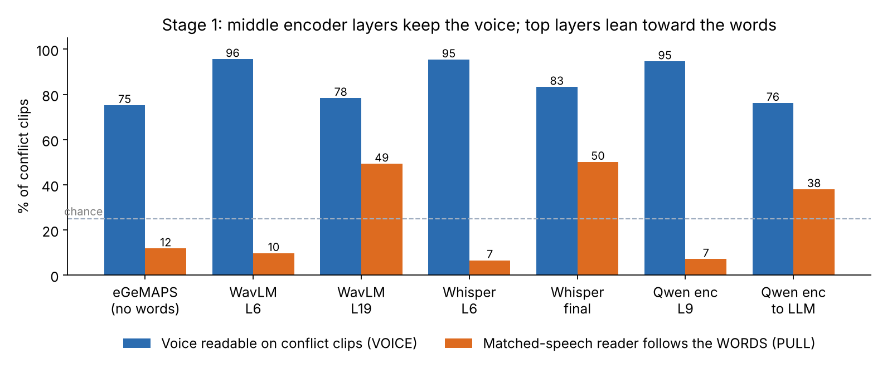
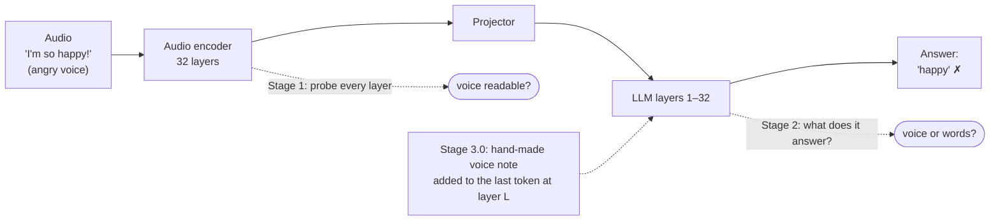
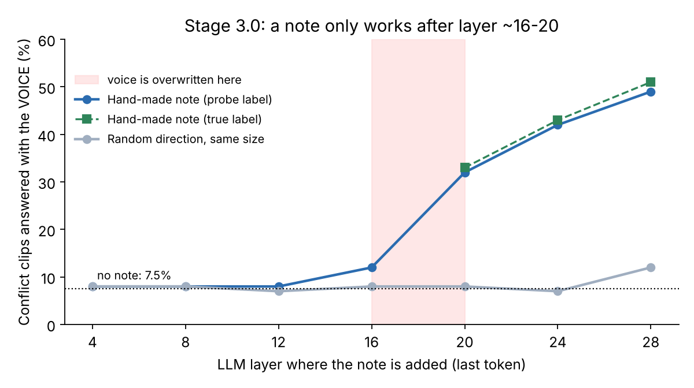
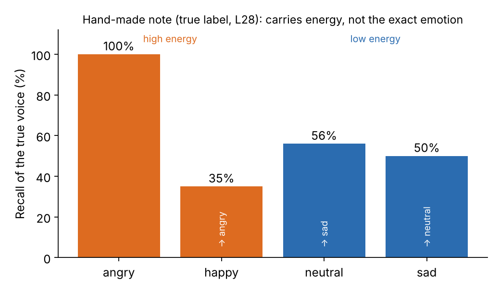

# Voice vs. Words: Where Audio LLMs Lose the Tone of Voice

**Azizbek Abdullaev** · Tashkent University of Information Technologies (TATU) · azizhan.abdullayev.99@gmail.com
*Ongoing research, last updated November 2026.*

> Say *"I'm so happy!"* in an angry voice and ask Qwen2-Audio how the speaker sounds. It answers **"happy"**.
> This repository asks **why**: is the angry voice never heard, or is it heard and then ignored?

## TL;DR

On EMIS, a dataset where every sentence is spoken in all four voice emotions, I traced the voice through Qwen2-Audio-7B-Instruct step by step:

1. **The encoder hears the voice.** A linear probe on the middle layers of the audio encoder reads the voice emotion on **~95%** of clips where the words disagree with it. Top encoder layers drift toward the words, and the vector handed to the LLM is already partly word-pulled.
2. **The LLM does not use it.** Asked how the speaker sounds, Qwen2-Audio follows the **words** on 81% of conflict clips and the **voice** on only 7.5%. Prompting it to "ignore the words" does not help (6.9%).
3. **A hand-made "voice note" written into the LLM shows where the voice gets lost.** Adding a voice direction to the answer token does nothing at layers 4–16 and works only from layer ~20 on. The voice is overwritten around layers 16–20. Even at its best, the hand-made note carries **energy, not emotion** (happy becomes "angry"), and it breaks questions about the words.

So the failure is mainly one of **use, not encoding**: the information is there in the encoder, but it does not survive into the LLM's answer.



## Background

### The model: Qwen2-Audio

Qwen2-Audio [2] is an open audio language model from Alibaba's Qwen team. You give it a sound clip and a question in text, and it answers in text. Inside, it has three parts:

- **An audio encoder that listens.** It starts from Whisper-large-v3, a speech-recognition model, and turns the clip into a sequence of vectors, roughly 25 per second of audio.
- **A small projector** that translates those vectors into the "language" of the LLM, so they can sit next to ordinary word tokens.
- **A 7B language model (Qwen-7B)** that reads the audio tokens together with the question and writes the answer.

The detail that matters for this project is where the encoder comes from. It was built to **transcribe speech**: its first job was to turn sound into words. The tone of voice still passes through it, but nothing in that original job asks the encoder to keep it.

### The problem: VoxParadox

VoxParadox [1] is the paper that made this problem easy to see. The authors built 2,000 test clips covering 10 voice-related tasks, such as emotion, pitch and speaking speed. In every clip **the words point to the wrong answer and only the voice tells the truth**. Think of a calm voice saying *"I'm shouting at you right now."* Qwen2-Audio got just **14.85%** right, mostly picking the answer the words suggested.

They also proposed a fix. In plain terms, it lets the model listen to several depths of the encoder at once (layers 5, 15, 25, 30 and the last one) instead of only the top. A small text model reads the question and decides how much weight each depth gets. They then fine-tune the whole LLM and finish with preference training (DPO), rewarding correct options over wrong ones. That lifts Qwen2-Audio from 14.85% to **72.30%**.

It works, but it is heavy: the full LLM is fine-tuned on more than a million examples, and the mixing is steered only by the **question**, never by the audio itself.

### Where this repository fits

VoxParadox shows that the model fails and that a large retraining can fix it. This repository asks the step in between: **where exactly does the voice get lost?** The early stages agree with VoxParadox that the middle encoder layers hold the voice best. They add that the top encoder layers lean toward the words specifically when the words and voice disagree, and that inside the LLM the voice is overwritten around layers 16–20.

## Pipeline studied



| Stage | Question | Write-up |
|---|---|---|
| 1 | Does the encoder still carry the voice when the words disagree? | [docs/stage1_encoder_probes.md](docs/stage1_encoder_probes.md) |
| 2 | Does the LLM answer with the voice or the words? | [docs/stage2_llm_behaviour.md](docs/stage2_llm_behaviour.md) |
| 3.0 | Can a hand-made voice direction change the answer, and where? | [docs/stage3_steering.md](docs/stage3_steering.md) |

## Key results

**Stage 1 — encoder probes** (EMIS, 1,248 clips, 5 folds split by sentence, chance 25%)

| Encoder layer | Voice readable on conflict clips | Reader trained on matched speech follows the words |
|---|---|---|
| eGeMAPS (acoustic features, no words) | 75% | 12% |
| Qwen2-Audio encoder, layer 9 | **95%** | **7%** |
| Qwen2-Audio encoder output (what the LLM receives) | 76% | 38% |

The same top-layer drift appears in **WavLM**, which was never trained on text (49% at L19). So it is not only a side effect of ASR training.

**Stage 2 — behaviour** (Qwen2-Audio, 240 held-out clips): conflict clips → voice **7.5%**, words **80.8%**. When it follows the words it is confident (mean probability ≈ 0.90).

**Stage 3.0 — hand-made voice note** (no training, 240 held-out clips)



- A note built from a frozen probe's guess (49%) is as good as one built from the true label (51%). A random direction of the same size does nothing, so the effect comes from the voice direction, not from noise.
- It only works **after** layer ~16–20. Before that point, anything written into the last token gets overwritten.
- It carries **arousal (energy), not the exact emotion**: happy voices become "angry" and sad and neutral get swapped.
- It acts like a **sticker**: it also changes answers to "What emotion do the speaker's words express?" (correct 84.7% → 57.6%).



## What I learned (and what surprised me)

- **I predicted the wrong layer.** Before Stage 3.0, I wrote down that the note should work *before* the point where the voice fades. It works only *after* it. I kept the pre-registered prediction and report it as wrong.
- **Probe accuracy ≠ model behaviour.** A 95%-accurate probe on the encoder is far better at this task than the 7B LLM it feeds. "The model represents X" and "the model uses X" are different claims.
- **A fixed direction is the wrong kind of fix.** It biases toward a pole (high vs low energy) instead of restoring the specific voice, and it doesn't know which question is being asked.

## Honest limitations

- **Synthetic speech.** EMIS is TTS. Humans recognise its intended emotion only 39–62% of the time, yet probes reach ~98% on StyleTTS2, so probes may partly read TTS fingerprints. Real-speech tests are planned.
- **Speaker and TTS overlap.** Folds are split by sentence, so the same 10 speakers and 3 TTS systems appear in training and test.
- **Best settings chosen on the test clips** in Stage 3.0 (7 layers × 3 strengths), so its top numbers are slightly optimistic. The layer pattern holds at every strength.
- **One model steered** (Qwen2-Audio, LLM body in 8-bit). Audio Flamingo 3 and Voxtral were checked for behaviour only.
- Stage 2 per-layer probes inside the LLM are not released yet: only a 60-clip pilot exists in this write-up, which is too small to trust layer by layer.

## Status

Stages 1–3.0 are the diagnosis and are public here. **A method built on these findings is in progress and not released yet**; this repository will link to the paper when it is out.

## Reproducing

See [code/README.md](code/README.md) and [data/README.md](data/README.md). No audio is redistributed; download each dataset from its original source under its own licence. `python scripts/make_figures.py` regenerates the figures from the reported numbers.

## References

[1] Jiacheng Pang, Ashutosh Chaubey, Mohammad Soleymani. *Do Audio LLMs Listen or Read? Analyzing and Mitigating Paralinguistic Failures with VoxParadox.* ICML 2026. arXiv:2605.27772.

[2] Yunfei Chu et al. *Qwen2-Audio Technical Report.* arXiv:2407.10759, 2024.

### Also related

- LISTEN (EACL 2026): lexical dominance in audio-LLM emotion tasks.
- Heard but Not Heeded (Koduru et al., 2026, arXiv 2609.00727): paralinguistic style is encoded but lost before the output.
- Represented but Ignored (Peng & Nuchged, 2026, arXiv 2608.19211): class-mean injection at the answer position; matched-content data, no word–voice conflict.
- When Vocal Tone and Literal Meaning Diverge (Chen et al., 2026, arXiv 2608.28966): LoRA fine-tuning on synthetic conflict clips; probing shows acoustic info fading in deeper LLM layers.
- EMIS dataset: https://zenodo.org/records/19207001 (code: github.com/AI-Unicamp/SLM-ER-Evaluation).
- Activation steering: Turner et al. 2023 (ActAdd); Rimsky et al., ACL 2024 (CAA).

BibTeX for [1] and [2]:

```bibtex
@inproceedings{pang2026voxparadox,
  title     = {Do Audio LLMs Listen or Read? Analyzing and Mitigating Paralinguistic Failures with VoxParadox},
  author    = {Pang, Jiacheng and Chaubey, Ashutosh and Soleymani, Mohammad},
  booktitle = {Proceedings of the International Conference on Machine Learning (ICML)},
  year      = {2026},
  note      = {arXiv:2605.27772}
}

@article{chu2024qwen2audio,
  title   = {Qwen2-Audio Technical Report},
  author  = {Chu, Yunfei and Xu, Jin and Yang, Qian and Wei, Haojie and Wei, Xipin and Guo, Zhifang and Leng, Yichong and Lv, Yuanjun and He, Jinzheng and Lin, Junyang and Zhou, Chang and Zhou, Jingren},
  journal = {arXiv preprint arXiv:2407.10759},
  year    = {2024}
}
```

## Citing this repository

See [CITATION.cff](CITATION.cff).
