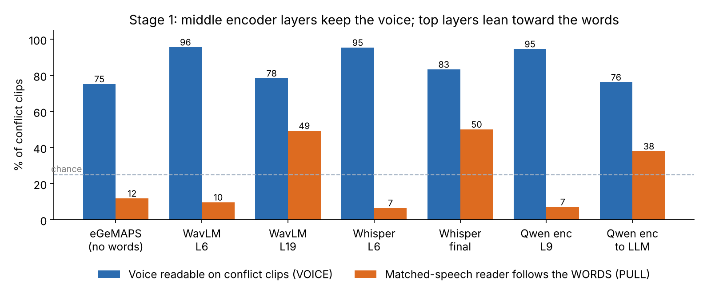

# Stage 1 — Does the encoder still hear the voice when the words disagree?

## The idea in plain words

Take *"I'm so happy!"* said in an angry voice. Before blaming the LLM, check the audio encoder: if its features no longer tell angry from happy, the LLM never had a chance. If they do, the problem is later.

A **linear probe** is a tiny classifier (here: standardise + logistic regression) trained on frozen features. If even a linear model can read the voice emotion from a layer, that information is clearly present there.

## Data

**EMIS** (1,248 clips, 3 TTS systems: CosyVoice2, F5-TTS, StyleTTS2; 104 sentences). Every sentence is spoken in all four voice emotions (angry, happy, neutral, sad), so **the words carry no information about the voice**. That crossed design is what makes the test clean.

- agree: 312 clips (words and voice match)
- conflict: 702 clips (they differ)
- neutral words: 234 clips

**Splits:** 5 folds grouped by sentence, so no test sentence is seen in training.

## Encoders

Every layer, mean over real (non-padding) frames, one new probe per layer:

- **eGeMAPS** (88 acoustic functionals, no words at all) — the baseline
- **WavLM-large** (self-supervised, never trained on text)
- **Whisper-large-v3 encoder** (ASR)
- **Qwen2-Audio encoder** (32 layers + `pooled_ln`, exactly what the projector reads)

## Three measures (chance 25%)

| Name | Trained on | Scored on | What it tells you |
|---|---|---|---|
| VOICE | all clips | agree / conflict separately | Is the voice readable at all? |
| WORDS | all clips, word emotion | explicit / implicit sentences | Are the words readable? |
| PULL | **agree clips only** (like natural speech) | conflict clips: % following the words | If you learn on matched speech, which cue do you end up using? |

PULL is the interesting one. In normal speech, words and voice usually agree, so a reader can use either. PULL shows which one it picked up.

## Results

| Encoder | Layer | VOICE agree | VOICE conflict | WORDS explicit | WORDS implicit | PULL → words | PULL → voice |
|---|---|---|---|---|---|---|---|
| eGeMAPS | functionals | 76.0 | 75.2 | 45.5 | 24.4 | 11.8 | 67.1 |
| WavLM | L6 (best) | 94.9 | 95.6 | 62.8 | 21.8 | 9.7 | 79.9 |
| WavLM | L19 (worst PULL) | 84.0 | 78.4 | 91.0 | 30.6 | 49.3 | 33.8 |
| Whisper | L6 (best) | 96.8 | 95.4 | 63.9 | 20.5 | 6.6 | 82.9 |
| Whisper | final_ln | 85.6 | 83.3 | 89.3 | 35.0 | 50.1 | 33.8 |
| Qwen2-Audio | L9 (best) | 96.8 | 94.6 | 61.8 | 17.7 | 7.1 | 82.8 |
| Qwen2-Audio | L31 | 89.1 | 77.2 | 83.1 | 35.5 | 34.8 | 44.6 |
| Qwen2-Audio | pooled_ln (→ LLM) | 82.0 | 76.2 | 81.2 | 32.3 | 38.0 | 43.0 |

## What it means

1. **Middle layers keep the voice cleanly.** All three neural encoders: VOICE ≈ 95% on both agree and conflict; PULL 5–10%, at or below the no-words baseline. Qwen layers 6–13 are all ≥ 93.5% on conflict.
2. **Top layers lean toward the words.** PULL rises to 34–50%, three to four times the eGeMAPS baseline, and most of PULL's mistakes are the words' emotion.
3. **The vector the LLM receives is already word-pulled.** PULL 38% at `pooled_ln` vs 7% at L9. Part of the word bias exists before the LLM.
4. **The voice is not erased, it is out-shouted.** VOICE stays 76–85% at the top (trained on mixed data), but a reader trained on matched speech follows the words. Same information, different shortcut.
5. **Not only an ASR effect.** WavLM, never trained on text, shows the same top-layer pull.
6. **TTS colouring is small.** eGeMAPS errors fall on the words' emotion about as often as random (36% vs ~33%).

## Caveats

- StyleTTS2 is the hardest for humans (39.4%) but the easiest for probes (~98%), so probes may read TTS-specific "fingerprints". Needs real speech.
- "Best layer" is picked on the same folds. It is harmless here because L6–L13 is a flat plateau.
- Probe accuracy says what *can* be read, not what the LLM *uses*. That is Stage 2.
- An earlier check on CREMA-D (neutral words) found emotion readable at the encoder output (Whisper 75% final vs 77% best). It could not see the word pull, because CREMA-D's words carry no emotion.
