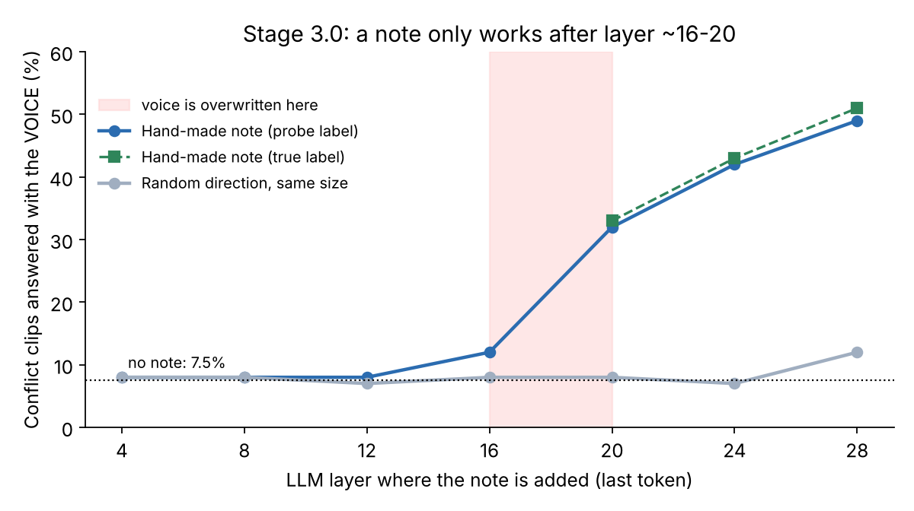
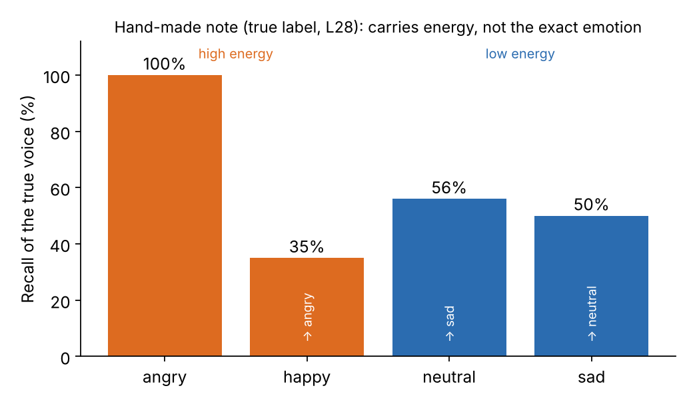

# Stage 3.0 — A hand-made "voice note": can we push the answer, and where?

## The idea in plain words

The LLM predicts its answer from the hidden state of the **last token** (the "desk" where the answer is formed). If I write a small "this voice is angry" signal onto that desk at some layer, does the answer change? Trying every layer tells me **where** the voice can still be used.

This is a diagnostic, not a method. No weights change; it is a forward hook that adds a vector after layer L.

## How the note is built

- **Voice direction for emotion e** = mean last-token state of clips whose voice is e, minus the mean of all clips. It is computed on the other 4 folds. EMIS's crossed design averages the words out.
- **Strength:** 0.5, 1 or 2 × the typical spread between clips at that layer.
- **Three kinds of push:**
  - **probe:** label from the Stage 1 frozen probe on encoder L9 (~95% correct), so no LLM training at all;
  - **oracle:** the true voice label, a ceiling;
  - **random:** a random direction of the same size, a control.
- **Sanity check:** with no push, the hooked model matched Stage 2 answers on 234/240 clips.

Data: 240 held-out EMIS clips (120 conflict, 60 agree, 60 neutral words). Layers 4, 8, …, 28.

## Results

| | Conflict: says voice | Agree correct | Neutral words correct |
|---|---|---|---|
| No push | 7.5% (words 80.8%) | 71.7% | 33.3% |
| Oracle, L28, ×2 | 50.8% (words 33.3%) | 95.0% | 43.3% |
| Probe, L28, ×2 | 49.2% | 91.7% | 41.7% |
| Random, best | 9.2% | 68.3% | 26.7% |

By layer (conflict → voice, strength 2):

| Layer | 4 | 8 | 12 | 16 | 20 | 24 | 28 |
|---|---|---|---|---|---|---|---|
| Probe push | 8 | 8 | 8 | 12 | 32 | 42 | 49 |
| Random push | 8 | 8 | 7 | 8 | 8 | 7 | 12 |

## Findings

1. **The push works, and it is the voice.** The mean probability of the voice word on conflict clips rose from 0.09 to 0.51. Random pushes did nothing.
2. **No LLM training reaches half the ceiling.** Probe (49%) ≈ oracle (51%).
3. **It only works late.** Layers 4–16 have at most +5 points at any strength; the effect starts at L20 and grows to L28. The voice's share of last-token variance falls from 0.16 (L4) to 0.07 (L28). *Reading:* the voice is overwritten between about layers 16 and 20, and anything written before that is overwritten too.
4. **It carries energy, not emotion.** Oracle at L28: angry 100%, happy 35% (mostly "angry"), neutral 56% (else "sad"), sad 50% (else "neutral"). Confusions follow arousal.
5. **It is a sticker.** The same note (probe label, L20) also changes the answer to *"What emotion do the speaker's words express?"*: correct falls from 84.7% to 57.6%.
6. **Not one TTS's quirk.** Similar across TTS systems (52 / 45 / 55%), word emotions and explicit/implicit sentences.
7. **The note is huge relative to the natural signal:** about 12× (L4) to 29× (L28) the natural voice difference. It overrides rather than restores.

## Pre-registered rules and a wrong prediction

| Rule (fixed before the run) | Result |
|---|---|
| Can't move the model | No |
| Real voice direction (beats random) | **Yes** |
| Probe ≈ oracle | **Yes** |
| Push breaks the model | No |

Before the run I predicted that the best layer would sit **before** the point where the voice fades inside the LLM. **That was wrong**: notes work only after it. The pre-registered tie-break ("trust the causal test over the probes") applied.

## Caveats

- The Stage 1 probe alone reads the voice on ~95% of conflict clips, so probe → note → LLM (49%) is worse than the probe by itself. Steering here is a diagnostic, not a solution.
- Settings chosen on the same 240 clips (7 layers × 3 strengths × 3 kinds) → top numbers slightly optimistic.
- The effect was still growing at ×2, but larger pushes start to damage the model (random at L28 ×2 drops agree accuracy to 62%).
- Only Qwen2-Audio, synthetic speech.

## Related

Activation Addition (Turner et al., 2023); Contrastive Activation Addition (Rimsky et al., ACL 2024); Represented but Ignored (Peng & Nuchged, 2026), which reports the same "bias toward a pole" limitation and emotion features correlated with RMS energy, on matched-content data without word–voice conflict.
